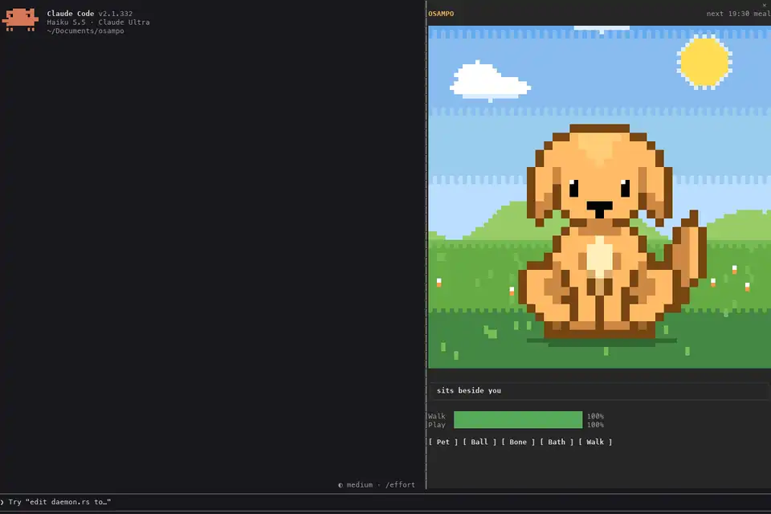

# Osampo

*[English version](README.md)*

## Pourquoi ?

Avec un agent de code, une session ne s'arrête jamais d'elle-même : il y a toujours une tâche
qui tourne, une question en attente, et « encore cinq minutes, il a bientôt fini ». J'ai
construit Osampo pour deux choses :

1. **Faire des pauses.** Le chiot s'impatiente quand je reste assis trop longtemps et réclame
   sa promenade aux heures prévues. Accepter, c'est se lever : la board part avec moi et
   compte mes pas.
2. **Respecter l'heure du coucher.** Ne plus me coucher à 2 h du matin « parce que Claude a
   bientôt fini ». Le soir, le chiot réclame sa dernière sortie, puis il va dormir, et l'écran
   passe en mode nuit.

**Osampo** (お散歩, *la promenade*) est un chiot en pixel art qui vit sur un petit écran ESP32
à côté de ton clavier. Il s'ennuie, s'endort et s'agite quand tu restes trop longtemps assis,
te réclame sa promenade, et pose la patte contre l'écran quand **Claude Code** t'attend.
Emmène la board en vraie promenade : le chiot marche, trotte ou court à ton allure. Sur le PC,
le même chien est posé sur ta barre des tâches.

| | | | |
|:-:|:-:|:-:|:-:|
|  |  |  |  |
| il vit sa vie | une caresse : il se roule | lance la balle | la brosse : c'est le bain |
|  |  |  |  |
| donne-lui un os | la laisse : promenade | Claude Code t'attend | il dort la nuit |

*Enregistré avec le simulateur desktop (`tools/demos.py`). Clips plus longs : `docs/media/*.mp4`.*

**Pas de board ? Le même chiot vit dans Claude Code.** Un panneau à côté du chat, dessiné avec
les sprites de la board ([installer](#mod-claude-code)) :



## L'idée

Osampo est un petit compagnon qui a ses propres besoins :

- **Besoins.** Le chiot a besoin de bouger, de jouer et de dormir. Sa jauge baisse quand tu
  travailles sans pause ; une promenade, un jeu ou une sieste la remplissent.
- **Rappels.** Aux heures que tu choisis, il apporte sa laisse et réclame sa promenade, sur la
  board et sur le PC en même temps. Accepter ou reporter d'un côté vaut pour les deux.
- **Une vraie promenade.** Emporte la board : son capteur de mouvement compte tes pas, et le
  chiot marche, trotte ou galope en conséquence. Le bilan de la promenade reste sur la board.
- **Claude Code.** Quand une session Claude Code attend ta réponse, le chiot s'assoit et
  gratte l'écran ; ignoré, il se met à aboyer.
- **Gestes.** Toucher, caresser, appui long, lancer doucement la board (la balle !), la
  secouer, la retourner écran contre la table (dodo).


## Matériel

- [Waveshare ESP32-S3-Touch-LCD-1.83](https://www.waveshare.com/product/esp32-related/boards-kits/esp32-s3-touch-lcd-1.83.htm) :
  ESP32-S3, écran tactile 240 × 284, IMU, haut-parleur, chargeur de batterie, horloge RTC.
- Un PC Linux avec Bluetooth (BlueZ) ou un câble USB. Testé sous X11 (Cinnamon).

## Comment ça marche

```
 Claude Code ──hook──┐
 clavier / souris ───┤
 heure, rappels ─────┤     Bluetooth LE ou USB        ┌──────────────────┐
                     ▼   ──── lignes JSON ─────────▶  │  board Osampo    │
              osampo-daemon ◀──── événements ───────  │  firmware chiot  │
                     │                                 └──────────────────┘
       socket Unix   │
                     ▼
     osampo-pc (icône + chien sur la barre)   osampo-reglages (réglages)
```

- **`osampo-daemon`** (Rust, service systemd utilisateur) rassemble l'heure, ton activité au
  clavier et à la souris, l'attente de Claude Code et les rappels, et envoie une ligne JSON à
  la board deux fois par seconde, par Bluetooth LE ou par l'USB série. La board répond par des
  événements (promenade commencée, rappel accepté…).
- **Le firmware** (ESP-IDF, C++, interface [Slint](https://slint.dev)) porte la logique du
  chiot : besoins, humeurs, gestes, podomètre, bilan de promenade.
- **`osampo-pc`** montre le chien dans la zone de notification et posé sur la barre des
  tâches, avec notifications et sons. **`osampo-reglages`** édite les réglages.
- Le **simulateur desktop** fait tourner le même chiot dans une fenêtre, pour le
  développement et les démos.

Schémas de chaque partie (générés depuis un modèle [LikeC4](https://likec4.dev)) :
[docs/architecture.md](docs/architecture.md).

## Installer (Linux)

Prérequis :
- pour compiler : Rust (`rustup`, sans `sudo`), un compilateur C et son éditeur de liens, et
  les paquets de développement de D-Bus (Bluetooth) et de Slint (interface) : sous
  Debian/Ubuntu, `build-essential pkg-config libdbus-1-dev libfontconfig-dev libxkbcommon-dev` ;
- pour tourner : une session X11, une zone de notification compatible StatusNotifierItem,
  `paplay` (PulseAudio ou PipeWire) pour les sons, BlueZ pour le Bluetooth.

```sh
git clone https://github.com/agaches/osampo
cd osampo
installer/linux/installer.sh
```

L'installeur compile tout et l'installe pour ton utilisateur seulement :

- binaires dans `~/.local/bin/` (`osampo-daemon`, `osampo-pc`, `osampo-reglages`) ;
- ressources dans `~/.local/share/osampo/` ;
- service systemd utilisateur `osampo-daemon` et démarrage de `osampo-pc` avec la session ;
- hook Claude Code dans `~/.local/share/osampo/hooks/claude_wait.sh` (voir plus bas).

Options : `--serial <port>|auto|aucun` (lien USB), `--sans-ble` (sans Bluetooth),
`--sans-demarrer` (installer sans démarrer). Le relancer met à jour. Désinstaller :
`installer/linux/desinstaller.sh` (garde tes réglages et ton historique).

### Flasher la board

Avec [ESP-IDF 5.5](https://docs.espressif.com/projects/esp-idf/en/v5.5/esp32s3/get-started/) :

```sh
cd widgets/osampo/esp32
idf.py build
systemctl --user stop osampo-daemon      # un seul programme à la fois sur le port série
idf.py -p /dev/ttyACM0 flash
systemctl --user start osampo-daemon
```

La board s'annonce en Bluetooth sous le nom `osampo` ; le daemon la trouve seul. Le lien n'a
pas encore d'appairage ni de chiffrement (preuve de concept) : un appareil à portée peut se
connecter à la board, lui envoyer des commandes ou l'occuper pour que ton PC ne s'y connecte pas.

## Configurer

- **Application de réglages :** `osampo-reglages` (ou le menu du chien de la barre) :
  promenades, rappels, heures calmes, besoins, taille du chien sur la barre.
- **Fichier de réglages :** `~/.config/osampo/osampo.toml`. Chaque clé, avec sa valeur par
  défaut et ses bornes, est décrite dans [`widgets/osampo/config.toml`](widgets/osampo/config.toml).
  Le daemon relit le fichier toutes les 2 secondes et refuse un fichier invalide en entier.
- **Affichage X :** le daemon lit l'activité du clavier et de la souris par X, avec
  `DISPLAY=:0` et `~/.Xauthority` fixés dans son unité systemd. Si ta session diffère
  (`echo $DISPLAY $XAUTHORITY`), les surcharger par `systemctl --user edit osampo-daemon` ;
  sinon le journal le signale et ton activité n'est pas mesurée. Wayland n'est pas pris en charge.
  Sections principales : `[rappels]` et `[[rappel]]`, `[heures]` (jour, nuit, heures
  calmes), `[besoins]`, `[promenade]`, `[gestes]` (seuils de mouvement), `[ecran]`
  (luminosité), `[pc]` (chien sur la barre).
- **Claude Code :** ajouter le hook dans `~/.claude/settings.json` pour que le chiot sache
  quand Claude t'attend. Le JSON exact est dans [`daemon/hooks/README.md`](daemon/hooks/README.md).

## Mod Claude Code

Le chiot dans un panneau à côté du chat de Claude Code, sans board ni daemon. L'installer depuis
une session Claude Code :

```
/plugin install osampo --marketplace agaches/osampo
```

Répondre `y` pour ajouter le marketplace, puis choisir une portée. Depuis un shell :
`claude plugin install osampo --marketplace agaches/osampo`.

- Le panneau s'ouvre tout seul dans un terminal d'au moins 144 colonnes ; `/osampo` l'ouvre à
  toute largeur. Plus étroit, le chiot garde une ligne au-dessus du prompt.
- Il réclame sa promenade après 90 minutes de travail et aux heures des rappels, lève la patte
  quand Claude t'attend, aboie au bout de 2 minutes et dort la nuit. Mêmes valeurs que la board.
- Il prend les valeurs par défaut et ne lit pas ta config : `~/.config/osampo/osampo.toml`
  (rappels personnalisés, `seuil_reclame`, `retour_min`) ne le change pas.
- Boutons, ou `/osampo walk | snooze | pet | ball | bone | brush | hide | show`.
- Il tourne seul : il ne parle ni au daemon ni à la board. Pour eux, garder le hook ci-dessus.
- Développer : `claude --plugin-dir claude-mod` ; tests : `claude plugin test claude-mod` ;
  sprites : `python3 -I claude-mod/tools/gen_sprites.py`.

## Développer

```sh
tests/run_all.sh                         # Rust, C++, installeur, données personnelles, mod Claude Code, acceptance
cmake -B widgets/osampo/desktop/build -S widgets/osampo/desktop    # CMake, compilateur C++
cmake --build widgets/osampo/desktop/build
widgets/osampo/desktop/build/osampo --fake    # le chiot dans une fenêtre, données factices
python3 tools/demos.py                   # réenregistrer les démos (Xvfb, ffmpeg)
tools/architecture.sh                    # régénérer docs/architecture.md depuis LikeC4
```

- [Comment les sprites sont fabriqués](docs/sprites.fr.md) : chaque planche est générée par du code.
- [Exigences côté PC](docs/requirements.md), chacune couverte par un test d'acceptance dans
  `tests/acceptance/`.

## Crédits et licences

- Code : [MIT](LICENSE).
- Poses de face du chiot dérivées du chiot de **strawheart** (*Animals and Tea*,
  [mtsids.com](http://mtsids.com/)), sous CC-BY-SA 3.0.
- Sons du chiot : **AntumDeluge** sur Freesound (CC0).
- Cycle de marche d'après les principes du tutoriel de **Slynyrd**.
- Construit avec Slint, ESP-IDF, Tokio, btleplug, zbus et bien d'autres.

Liste complète, avec la licence de chaque ressource et dépendance : [LICENSE-ASSETS.md](LICENSE-ASSETS.md).
