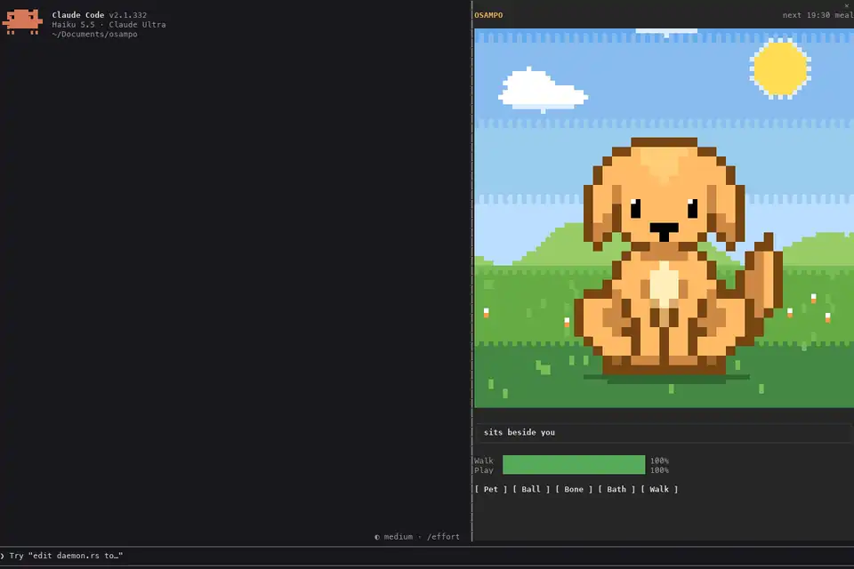

# Osampo

*[Version française](README.fr.md)*

## Why?

With a coding agent, a session never ends by itself: there is always a task running, a
question waiting, and "five more minutes, it's almost done". I built Osampo for two things:

1. **Taking breaks.** The puppy gets restless when I sit too long and asks for its walk at
   the times I set. Saying yes means standing up: the board comes with me and counts my steps.
2. **Keeping my bedtime.** No more going to bed at 2 a.m. "because Claude is almost done". In
   the evening, the puppy asks for its last walk, then goes to sleep, and the screen switches
   to night mode.

**Osampo** (お散歩, *a walk*) is a pixel-art puppy that lives on a small ESP32 screen next to
your keyboard. It gets bored, sleepy and restless when you sit too long, asks you to take it
for a walk, and puts its paw on the screen when **Claude Code** is waiting for you. Take the
board out for a real walk and the puppy walks, trots or runs at your pace. On the PC, the same
dog sits on your taskbar.

| | | | |
|:-:|:-:|:-:|:-:|
|  |  |  |  |
| lives its life | pet it: it rolls over | throw the ball | brush it: bath time |
|  |  |  |  |
| give it a bone | leash on: walk time | Claude Code waits for you | sleeps at night |

*Recorded with the desktop simulator (`tools/demos.py`). Longer clips: `docs/media/*.mp4`.*

**No board? The same puppy lives in Claude Code.** A panel beside the chat, drawn from the
board's own sprites ([install](#claude-code-mod)):



## The idea

Osampo is a small companion with needs of its own:

- **Needs.** The puppy needs to move, play and sleep. Its mood gauge drops while you work
  without a break; a walk, a game or a nap fills it again.
- **Reminders.** At the times you choose, it brings its leash and asks for a walk, on the
  board and on the PC at once. Accept or snooze from either side.
- **A real walk.** Take the board with you: its motion sensor counts your steps, and the
  puppy walks, trots or gallops to match. A summary of the walk is kept on the board.
- **Claude Code.** When a Claude Code session waits for your answer, the puppy sits and
  scratches the screen; ignored, it starts barking.
- **Gestures.** Tap, stroke, long-press, throw the board gently (fetch!), shake it, turn
  it face down (sleep).


## Hardware

- [Waveshare ESP32-S3-Touch-LCD-1.83](https://www.waveshare.com/product/esp32-related/boards-kits/esp32-s3-touch-lcd-1.83.htm):
  ESP32-S3, 240 × 284 touch screen, IMU, speaker, battery charger, RTC.
- A Linux PC with Bluetooth (BlueZ) or a USB cable. Tested on X11 (Cinnamon).

## How it works

```
 Claude Code ──hook──┐
 keyboard / mouse ───┤
 clock, reminders ───┤      Bluetooth LE or USB       ┌──────────────────┐
                     ▼   ─────── JSON lines ───────▶  │  Osampo board    │
              osampo-daemon ◀────── events ─────────  │  puppy firmware  │
                     │                                 └──────────────────┘
          Unix socket│
                     ▼
     osampo-pc (tray icon + dog on the taskbar)   osampo-reglages (settings)
```

- **`osampo-daemon`** (Rust, systemd user service) gathers the time, your keyboard and mouse
  activity, Claude Code's waiting state and the reminders, and sends one line of JSON to the
  board twice a second, by Bluetooth LE or USB serial. The board answers with events
  (walk started, reminder accepted…).
- **The firmware** (ESP-IDF, C++, [Slint](https://slint.dev) UI) holds the puppy's logic:
  needs, moods, gestures, the pedometer, the walk summary.
- **`osampo-pc`** shows the dog in the tray and sitting on the taskbar, with notifications and
  sounds. **`osampo-reglages`** edits the settings.
- The **desktop simulator** runs the same puppy in a window, for development and demos.

Diagrams of each part (generated from a [LikeC4](https://likec4.dev) model):
[docs/architecture.md](docs/architecture.md).

## Install (Linux)

Prerequisites:
- to build: Rust (`rustup`, no `sudo`), a C compiler and linker, and the development packages
  for D-Bus (Bluetooth) and Slint (UI): on Debian/Ubuntu,
  `build-essential pkg-config libdbus-1-dev libfontconfig-dev libxkbcommon-dev`;
- to run: an X11 session, a tray that supports StatusNotifierItem, `paplay` (PulseAudio or
  PipeWire) for the sounds, BlueZ for Bluetooth.

```sh
git clone https://github.com/agaches/osampo
cd osampo
installer/linux/installer.sh
```

The installer builds everything and installs it for your user only:

- binaries in `~/.local/bin/` (`osampo-daemon`, `osampo-pc`, `osampo-reglages`);
- resources in `~/.local/share/osampo/`;
- the `osampo-daemon` systemd user service and the `osampo-pc` autostart entry;
- the Claude Code hook in `~/.local/share/osampo/hooks/claude_wait.sh` (see below).

Options: `--serial <port>|auto|aucun` (USB link), `--sans-ble` (no Bluetooth),
`--sans-demarrer` (install without starting). Run it again to update. Uninstall:
`installer/linux/desinstaller.sh` (keeps your settings and history).

### Flash the board

With [ESP-IDF 5.5](https://docs.espressif.com/projects/esp-idf/en/v5.5/esp32s3/get-started/):

```sh
cd widgets/osampo/esp32
idf.py build
systemctl --user stop osampo-daemon      # one program at a time on the serial port
idf.py -p /dev/ttyACM0 flash
systemctl --user start osampo-daemon
```

The board shows up over Bluetooth as `osampo`; the daemon finds it on its own. The link has no
pairing or encryption yet (proof of concept): a device in range can connect to the board, send
it commands, or keep it busy so your PC cannot connect.

## Configure

- **Settings app:** run `osampo-reglages` (or from the tray dog's menu): walks, reminders,
  quiet hours, needs, the size of the dog on the taskbar.
- **Settings file:** `~/.config/osampo/osampo.toml`. Every key, with its default value and
  allowed range, is documented in [`widgets/osampo/config.toml`](widgets/osampo/config.toml).
  The daemon re-reads the file every 2 seconds and rejects an invalid file as a whole.
- **X display:** the daemon reads keyboard and mouse activity from X, with `DISPLAY=:0` and
  `~/.Xauthority` set in its systemd unit. If your session differs (`echo $DISPLAY $XAUTHORITY`),
  override them with `systemctl --user edit osampo-daemon`; otherwise the journal says so and
  your activity is not measured. Wayland is not supported.
  Main sections: `[rappels]` and `[[rappel]]` (reminders), `[heures]` (day, night, quiet
  hours), `[besoins]` (needs), `[promenade]` (walks), `[gestes]` (motion thresholds),
  `[ecran]` (brightness), `[pc]` (taskbar dog).
- **Claude Code:** add the hook to `~/.claude/settings.json` so the puppy knows when Claude
  waits for you. The exact JSON is in [`daemon/hooks/README.md`](daemon/hooks/README.md).

## Claude Code mod

The puppy in a panel beside your Claude Code chat, no board or daemon needed. Install it from a
Claude Code session:

```
/plugin install osampo --marketplace agaches/osampo
```

Answer `y` to add the marketplace, then pick a scope. From a shell:
`claude plugin install osampo --marketplace agaches/osampo`.

- The panel opens by itself in a terminal at least 144 columns wide; `/osampo` opens it at any
  width. Narrower, the puppy keeps one line above the prompt.
- It asks for its walk after 90 minutes of work and at the reminder times, raises its paw when
  Claude waits for you, barks after 2 minutes, and sleeps at night. Same defaults as the board.
- It uses the default values and does not read your config: `~/.config/osampo/osampo.toml`
  (custom reminders, `seuil_reclame`, `retour_min`) does not change it.
- Buttons, or `/osampo walk | snooze | pet | ball | bone | brush | hide | show`.
- It runs on its own: it does not talk to the daemon or the board. For those, keep the hook above.
- Develop: `claude --plugin-dir claude-mod`; tests: `claude plugin test claude-mod`; sprites:
  `python3 -I claude-mod/tools/gen_sprites.py`.

## Develop

```sh
tests/run_all.sh                         # Rust, C++, installer, publication check, Claude mod, acceptance
cmake -B widgets/osampo/desktop/build -S widgets/osampo/desktop    # needs CMake, a C++ compiler
cmake --build widgets/osampo/desktop/build
widgets/osampo/desktop/build/osampo --fake    # the puppy in a window, with fake data
python3 tools/demos.py                   # re-record the README demos (needs Xvfb, ffmpeg)
tools/architecture.sh                    # regenerate docs/architecture.md from LikeC4
```

- [How the sprites are made](docs/sprites.md): every sprite sheet is generated by code.
- [PC-side requirements](docs/requirements.md) (French), each one covered by an acceptance
  test in `tests/acceptance/`.

Most code comments and the puppy's texts on the board and the PC are in French; the Claude
Code mod is in English.

## Credits and licenses

- Code: [MIT](LICENSE).
- Front-facing puppy poses derived from **strawheart**'s puppy (*Animals and Tea*,
  [mtsids.com](http://mtsids.com/)), under CC-BY-SA 3.0.
- Puppy sounds from **AntumDeluge** on Freesound (CC0).
- Walk cycle after the principles of **Slynyrd**'s pixel-art walk-cycle tutorial.
- Built with Slint, ESP-IDF, Tokio, btleplug, zbus and many others.

Full list, with the license of each asset and dependency: [LICENSE-ASSETS.md](LICENSE-ASSETS.md).
